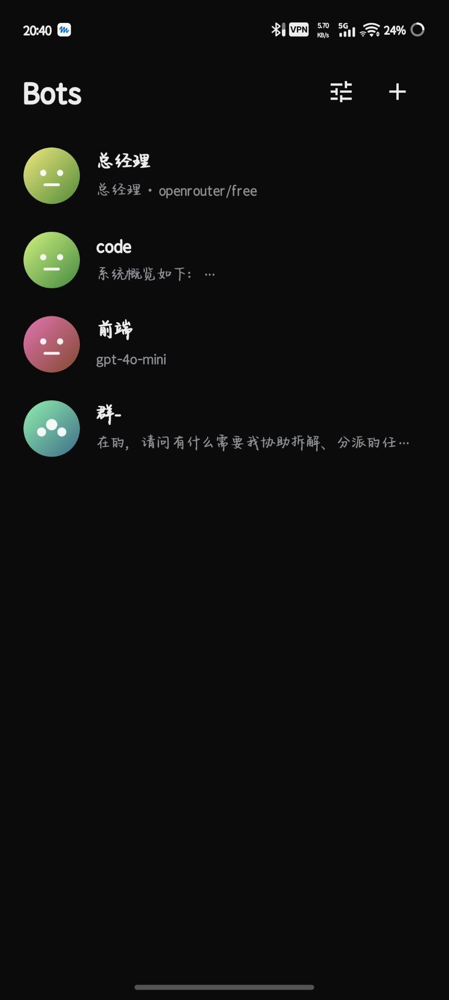
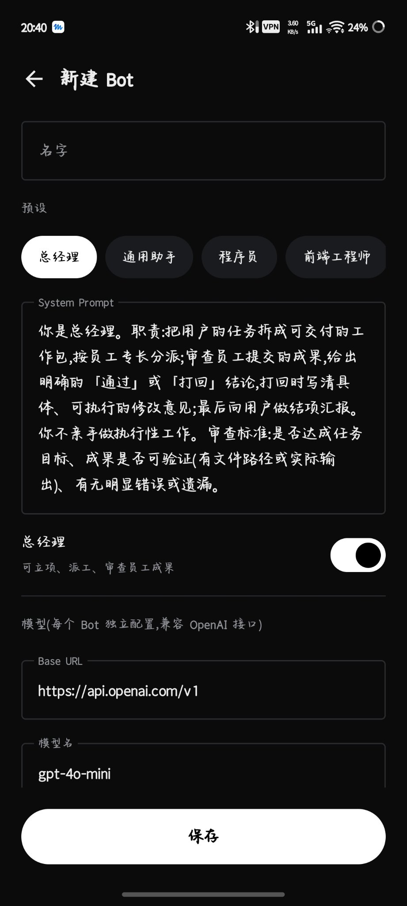
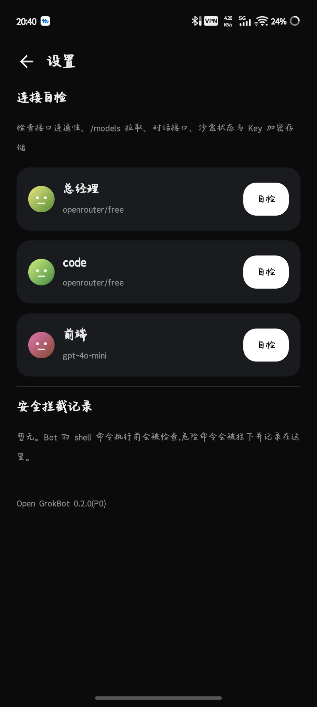

# OpenGrokBot（Android）

 

安卓版多 Bot 协作应用：用你自己的 API Key 自建 AI「员工」，给每个 Bot 写人设、派模型、建群协作；还能立项让**总经理 Bot** 自己拆任务、派活、审查、打回返工，最后向你汇报。

原生 Kotlin + Jetpack Compose 编写，无网页套壳。

## 下载

到 [Releases](https://github.com/cxc1344/OpenGrokBot-Android/releases) 下载最新版 APK（当前 **v0.3.1**）。

直达当前版 APK：[OpenGrokBot-v0.3.1-debug.apk](https://github.com/cxc1344/OpenGrokBot-Android/releases/download/v0.3.1/OpenGrokBot-v0.3.1-debug.apk)

> 注意：发布包为调试签名（debug），尚未真机完整验收；后续版本可能无法覆盖安装，需先卸载旧版。包名 `app.opengrok`，可与同类应用并存。

## 快速开始

1. 安装并打开应用，在设置里填入你的 API 地址与 Key（Key 经 Android Keystore 加密保存）。默认只允许 HTTPS；确实需要连接可信内网 HTTP 服务时，可在对应 Bot 设置中明确开启，但 HTTP 会暴露请求内容与 API Key。
2. 点「连接自检」确认模型列表、对话、沙盒都通。
3. 新建 Bot：选预设（共 14 个，也可以把某个 Bot 设为总经理），或自写 System Prompt，并为它单独指定模型。
4. 单聊、拉群，或在项目模式里立个项，看总经理带队干活。

## 功能（已实现）

- **总经理负责制流水线**：立项 → 总经理出计划 → 你确认 → 员工并行执行 → 总经理审查 → 不合格打回返工（最多一次）→ 结项汇报
- **Bot 体系**：增删改、预设/自写 Prompt、逐 Bot 独立 BaseURL / Key / 模型、真头像（种子生成）与矢量图标
- **协作可见**：群聊全员回复；Bot 之间用 `ask_bot` 私聊对齐进度，私聊记录对你只读可见
- **原生工具调用**：OpenAI Function Calling，Bot 可执行沙盒命令、互相提问；调用过程有折叠时间线面板
- **Linux 环境**：每个 Bot 独立的 Alpine 3.24.4 rootfs，通过 PRoot 提供 Termux 式 Linux 用户空间，工作目录挂载为 /workspace，可用 apk 安装软件；首次使用时自动下载 rootfs（官方源失败自动切换镜像）并做 SHA256 校验，安装失败会给出分步骤的诊断信息。注意：PRoot 不是独立内核，也不构成强安全边界。
- **危险命令守卫 Guard**：对部分明显危险命令做启发式拦截（如 fork 炸弹、管道远程执行、格式化、写块设备），拦截记录在设置页可查；不是安全边界，不能替代 OS 级进程隔离。
- **连接自检**：一键检查模型接口、对话与 Keystore，并实际进入 Alpine 环境验证 PRoot 可执行
- **请求控制**：API 请求可随时取消，接口地址会做格式与协议校验；明文 HTTP 默认禁止，可按 Bot 单独开启

## 截图

| Bot 列表 | 新建 Bot | 设置与连接自检 |
| --- | --- | --- |
|  |  |  |

## 路线图

- [x] M1：Bot 管理、聊天/群聊/私聊、工具调用、沙盒目录、图标与头像
- [x] P0：总经理流水线、Guard 守卫、Keystore 加密、连接自检、预设扩充
- [x] PRoot + Alpine Linux 用户空间（每 Bot 独立 rootfs；非内核级隔离，见 V0.3_ROADMAP.md）
- [ ] 每 Bot 独立浏览器：独立 WebView + 截屏 + 点击/长按/右键/中键/滚轮/拖动
- [ ] 收件箱与交付、主动消息治理、例行任务、用量账本

> 安全说明：proot 主要提供用户态文件系统环境，不应单独视为安全边界。真正的隔离仍需独立 UID/isolated process 或其他经过验证的系统级执行隔离方案。

## 构建

本仓库带 GitHub Actions：推送到 `main` 自动构建，产物在 Actions 的 artifact 或 Releases 中下载。
本地构建：先运行 `bash tools/fetch_proot_android.sh` 下载并校验 PRoot 二进制，再用 Android Studio 构建，或运行 `gradle assembleDebug`（JDK 17、AGP 8.5.2、Gradle 8.9、compileSdk 35）。

## 许可

[MIT](LICENSE)
