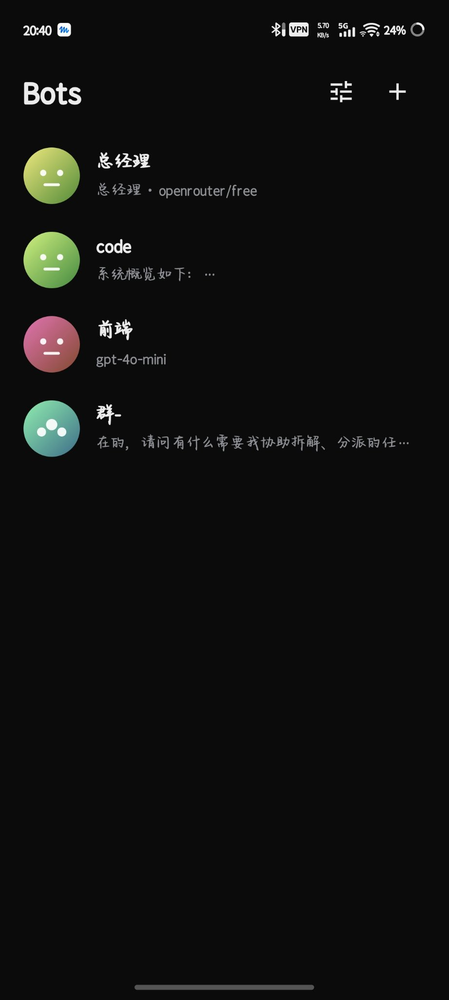
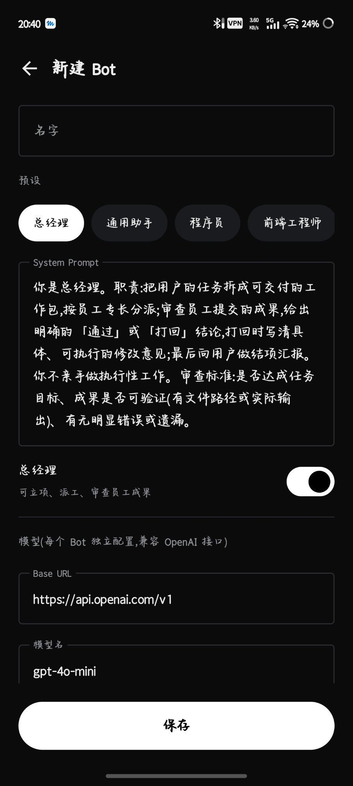
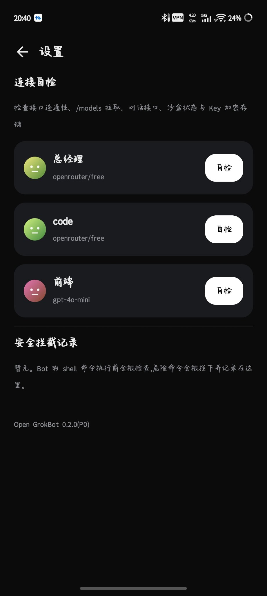

# BotHive

**把一队 AI「员工」、每人一个独立 Linux 沙箱，和一整套液态玻璃界面，装进你的 Android 手机。**

一个 APK · 本地运行 · 原生界面 · 自带 API Key

  
  
  
  

  
  
  
  
  

[下载](#下载) · [快速开始](#快速开始) · [功能](#功能已实现) · [截图](#截图) · [路线图](#路线图) · [构建](#构建)

安卓版多 Bot 协作应用：用你自己的 API Key 自建 AI「员工」，给每个 Bot 写人设、派模型、建群协作；还能立项让**总经理 Bot** 自己拆任务、派活、审查、打回返工，最后向你汇报。v0.4 起新增 **Agent 模式**：一位住在手机本地的设备 Agent，能读写你授权的手机文件夹、查看设备状态与应用使用时长、打开应用，并与云端 Bot 互相派活。

**v0.5.0** 在保留全部协作与 Agent 能力的基础上完成界面全面升级：以像素蜜蜂和蜂巢为核心视觉语言，并用桌宠式像素角色替换原先的无表情人头，让工作台更有陪伴感与辨识度。

**v0.5.8** 把液态玻璃从「自绘材质」推进到「真透镜」：在 v0.5.7 三档强度（不要 / 中等 / 最高）的基础上，最高档下模式胶囊指示器与开关滑块会采样应用背景层并实时折射（中心放大、边缘 SDF 法线推移、RGB 色散、速度拉伸形变）；采样边界与实现细节如实记录在 [TODO-GLASS-V2.md](TODO-GLASS-V2.md)。详见 [CHANGELOG](CHANGELOG.md)。

**v0.6.0** 把「全液态」推到底：应用里每一个单选控件——模式切换、岗位预设、服务商、模型、视觉档位、工作流选人——统一换成液态胶囊选择器，指示器是一颗会拉伸、回弹、跟手拖动的水滴；同时强调色开放自定义：默认蜂蜜黄，另有预设色板与 HSV 自选，全应用实时跟随。

**v0.6.2** 把聊天页改成悬浮层布局：顶栏、胶囊与输入区以玻璃层悬浮在内容之上；透镜升级为实时捕获内容层，真实文字滚动到玻璃下方会被折射采样；水滴透镜新增五档厚度，逐档递增。

**v0.6.3** 换上 LiquidGlass Pro 光学引擎：着色器全面重写——16 点黄金角 Vogel 散景采样、弯月面折射、内全反射暗槽、三维柔光箱高光与棱镜色散；全应用配色由暖调换成冷调「钛黑曜石」（深空底色、冷蓝灰卡片、白色发丝线），默认主题色仍为蜂蜜黄。透镜的采样源改为一层专用光学背景（底色、蜂窝与柔光池）：界面文字与控件不进入采样，折射只作用于这层背景——这是与 v0.6.2 实时内容捕获路线的明确取舍，换来任何滚动与动画下都不产生重影。

**v0.6.4** 给 Bot 装上了自己的浏览器：Bot 现在能独立开网页、点按钮、打字、翻页，每一步都附带截图，坐标按 0–1000 归一化，不挑屏幕尺寸。干活的时候你能在旁边围观——有个实时光标满屏跑，跟看人远程办公似的；看不下去了一键接管，自己上手弄完再「交还 AI」，它接着干。以前 Bot 查个网页要靠搜索接口拼拼凑凑，查不到就开始编；现在它自己去看，看错了你还能当场夺方向盘，胡说八道的概率当场没了。同版还住进来一只像素蜂 **Bix**：纯 Canvas 手绘、不占一张位图，Bot 写代码、想事情、搜东西时各演各的，派活时还会拉一队小弟开会；命令批准卡弹出来的时候，它举着一块 STOP 牌站在卡片上——想手滑点「同意」，先过它这关。浏览器还顺手修了三处：网页焦点不再抽风；接管时把浏览器关掉，AI 不再原地傻等一万年，会自己收尾；任务胶囊改成灵动岛式，展开几秒就缩回屏幕右侧的小球，再也不挡设置页。另外模型列表终于能搜了：OpenRouter 三百多个模型以前要翻到眼瞎，现在关键词一打，或者点一下「只看免费」，`:free` 的全蹦出来，换模型试手速的日子一去不返。

原生 Kotlin + Jetpack Compose 编写，无网页套壳。

## 下载

到 [Releases](https://github.com/cxc1344/BotHive/releases) 下载最新版 APK（当前 **v0.6.4**）。

直达当前版 APK：[BotHive-v0.6.4.apk](https://github.com/cxc1344/BotHive/releases/download/v0.6.4/BotHive-v0.6.4.apk)

> 注意：自 v0.4.8 起正式版使用固定项目签名，后续版本可直接覆盖安装。之前装的是调试版的话，换到正式版仍需先卸载一次（建议先用对话页的导出功能把重要对话存为 Markdown）。应用显示名已统一为 **BotHive**；包名仍为 `app.opengrok`，可与同类应用并存。

## 快速开始

1. 安装并打开应用，先在「设置 → Provider 预设」里把常用服务商的 Base URL 与 Key 存成预设（Key 经 Android Keystore 加密保存），之后建 Bot / Agent 时直接选用并点选模型。默认只允许 HTTPS；确实需要连接可信内网 HTTP 服务时，可在预设或对应 Bot 设置中明确开启，但 HTTP 会暴露请求内容与 API Key。
2. 点「连接自检」确认模型列表、对话、沙盒都通。
3. 新建 Bot：选预设（共 14 个，也可以把某个 Bot 设为总经理），或自写 System Prompt，并为它单独指定模型。
4. 单聊、拉群，或在项目模式里立个项，看总经理带队干活。

## 功能（已实现）

- **总经理负责制流水线**：立项 → 总经理出计划 → 你确认 → 员工并行执行 → 总经理审查 → 不合格打回返工（最多一次）→ 结项汇报
- **Bot 体系**：增删改、预设/自写 Prompt、逐 Bot 独立 BaseURL / Key / 模型、真头像（种子生成）与矢量图标
- **协作可见**：群聊全员回复；Bot 之间用 `ask_bot` 私聊对齐进度，私聊记录对你只读可见
- **原生工具调用**：OpenAI Function Calling，Bot 可执行沙盒命令、互相提问；调用过程有折叠时间线面板
- **Linux 环境**：每个 Bot / Agent 独立的 Ubuntu 24.04 rootfs，通过 PRoot 提供 Termux 式 Linux 用户空间，工作目录挂载为 /workspace，用 apt 安装软件，首次初始化自动预装 python3、nodejs、git 等常用工具；rootfs 从 Ubuntu 官方 cdimage 下载（镜像兜底）并按 SHA256SUMS 校验，安装失败会给出分步骤的诊断信息。注意：PRoot 不是独立内核，也不构成强安全边界。
- **危险命令守卫 Guard**：对部分明显危险命令做启发式拦截（如 fork 炸弹、管道远程执行、格式化、写块设备），拦截记录在设置页可查；不是安全边界，不能替代 OS 级进程隔离。
- **Provider 预设**：服务商连接（Base URL + Key）一次保存、处处复用；建 Bot 时可拉取该服务商的模型列表点选，不再逐个粘贴 Key
- **例行任务**：Bot 与 Agent 能用 schedule_task 给自己派定时活（一次性或每日），到点自动执行并在对话里汇报；设置页统一查看与删除
- **MCP 接入**：可添加远程 MCP 服务，其工具与内置工具一起出现在 Bot / Agent 的工具列表里
- **工作流**：步骤链编排——每步指定执行者与指令，{prev} 传递上一步输出，运行记录可翻看
- **后台保活**：前台服务守进程、被划掉自动拉起、开机自启，例行任务与主动消息不掉线（效果取决于系统授权）
- **技能包与命令批准**：可复用指令包可挂到任意 Bot / Agent；可开启「命令先批准」——每条 Shell 命令先过用户这关再执行
- **Agent 虚拟屏悬浮窗（v0.5.1）**：Agent 可在一块独立虚拟显示屏里操作 App，画面显示在可拖动的悬浮小窗中（带暂停/停止），你的主屏照常使用。前置条件为 Shizuku 已授权 + 已授予「显示在其他应用上层」，不满足时会明确提示并保持主屏模式
- **阅读体验（v0.5.4）**：聊天气泡支持 Markdown 渲染（标题、粗体、列表、代码块、GFM 表格）；内置子集化 Noto Serif SC 衬线字体，中英混排同一字族，代码与表格走等宽字体。同版修复虚拟屏在 Android 14+ 创建失败、Shizuku 授权后命令卡死与无障碍状态误报
- **专用手机模型（v0.5.5）**：可另配一个 AutoGLM 风格的看屏操作模型（任意 OpenAI 兼容接口，密钥经 Keystore 加密），用 `phone_task` 把整条操作任务交给它闭环执行（最多 15 步、卡住与黑屏自动中止）；虚拟屏改为跨轮次保持，不再每轮对话结束就释放
- **液态玻璃视觉系统（v0.5.7–v0.5.8）**：设置页三档自选界面玻璃与动画强度（不要 / 中等 / 最高）；v0.5.7 以自研 AGSL 着色器绘制玻璃面（圆角 SDF 透镜曲率明暗、边缘棱镜色散、漂移高光光斑）并把全部开关换成液态开关，v0.5.8 进一步让模式胶囊指示器与开关滑块在最高档下采样应用背景层做真实折射（Picture 录制背景层 → AGSL 采样，动画期间零重栅格化，失败或低版本自动回退材质）；开关支持拖动 1:1 跟手、过中点预览翻转、松手提交、橡皮筋与弹簧落位
- **全液态胶囊与主题色（v0.6.0）**：全部单选控件（模式切换、岗位预设、Provider、模型、手机模型预设、视觉档位、Agent 显示屏、工作流步骤执行者）统一为液态胶囊选择器——指示器水滴前缘快、后缘慢地拉伸流动，落位回弹挤压，固定分段可拖动跟手、按压膨胀回弹，动画强度随视觉档位联动（三档：不要=瞬时切换 / 中等=柔和弹簧 / 最高=完整液态物理）；强调色改为主题色系统：默认蜂蜜黄 #FFC83D，设置页提供 8 个预设色板与色相/饱和度/明度三滑杆自选，开关轨道、胶囊选中态、思考三点、状态点、发送钮等全应用强调色实时跟随（像素蜂本体色、选中蓝、危险红等语义色不随主题变）
- **Agent 模式（设备端）**：本地 Agent 可读写用户授权的手机文件夹、查看设备状态与今日应用使用时长、打开应用；可选接入 Shizuku 特权通道获得 shell 级能力；无障碍开启后以**视觉模式**操作屏幕——先截屏看图，再按画面方位用 0-1000 相对坐标点击 / 长按 / 拖动；与云端 Bot 通过同一套 ask_bot 私聊双向派活，全程可见
- **视觉看屏操作**：`screen_shot` 截屏并把图片直接发给模型，模型据此判断目标方位，再用 `tap_at` / `long_press` / `drag_at` 以相对坐标操作，应用按真实分辨率换算成像素执行手势；文字读屏（`screen_dump` / `tap_text`）作为备用通道。每次截屏的缩略图都保留在工具卡里可回看
- **AI 独立浏览器（v0.6.4）**：Bot 可用 browser_open / browser_mouse / browser_type / browser_nav / browser_close 五个工具独立浏览网页，0–1000 归一化坐标操作（点击、滚轮、拖动），每步自动附截图；用户可实时围观光标、一键接管手动操作后再交还 AI，接管期间关闭浏览器 AI 会自动收尾；任务胶囊为灵动岛式，自动缩为屏幕右侧小球不挡操作
- **像素蜂伙伴 Bix（v0.6.4）**：纯 Compose Canvas 绘制的像素蜜蜂伙伴，按 Bot 状态演出（写代码 / 思考 / 搜索 / 派活列队 / 审批守卫举 STOP 牌），零位图资源
- **可搜索模型列表（v0.6.4）**：模型选择器支持关键词搜索与「只看免费 (:free)」一键过滤，大模型目录（如 OpenRouter 300+）快速定位
- **对话置顶与消息重发**：侧边栏可置顶常用对话（最多 20 条，排在列表最前）；用户消息可一键「重发」——清除该条之后的内容再重新发送
- **复制 Bot**：一键复制一个人设/模型/Provider/技能包完全一致的 Bot（不含对话记录）
- **连接自检**：一键检查模型接口、对话与 Keystore，并实际进入 Ubuntu 环境验证 PRoot 可执行
- **请求控制**：API 请求可随时取消，接口地址会做格式与协议校验；明文 HTTP 默认禁止，可按 Bot 单独开启

## 截图

> 仓库当前保留的是 v0.4.x 的功能截图，展示 Bot 列表、新建 Bot 与设置/连接自检；它们不代表 v0.5.0 的新视觉。v0.5.0 运行时已升级为像素蜜蜂主题与桌宠式角色，发布版截图资源将随首个正式构建补充。

| 归档：Bot 列表 | 归档：新建 Bot | 归档：设置与连接自检 |
| --- | --- | --- |
|  |  |  |

## 路线图

- [x] M1：Bot 管理、聊天/群聊/私聊、工具调用、沙盒目录、图标与头像
- [x] P0：总经理流水线、Guard 守卫、Keystore 加密、连接自检、预设扩充
- [x] v0.5.0：像素蜜蜂视觉主题、蜂巢装饰与桌宠式 Bot 角色
- [x] PRoot + Alpine Linux 用户空间（每 Bot 独立 rootfs；非内核级隔离，见 V0.3_ROADMAP.md）
- [x] Ubuntu 24.04 环境、Provider 预设、Bot/Agent 双模式与设备工具（v0.4.0）
- [x] Agent 屏幕操作（无障碍看屏/点击/滑动/输入）与长期记忆（v0.4.0）
- [x] 例行任务（AI 自派定时任务）、远程 MCP 接入、工作流步骤链（v0.4.0）
- [ ] 每 Bot 独立浏览器：独立 WebView + 截屏 + 点击/长按/右键/中键/滚轮/拖动
- [ ] 收件箱与交付、主动消息治理、例行任务、用量账本

> 安全说明：proot 主要提供用户态文件系统环境，不应单独视为安全边界。真正的隔离仍需独立 UID/isolated process 或其他经过验证的系统级执行隔离方案。

## 构建

本仓库带 GitHub Actions：推送到 `main` 自动构建，产物在 Actions 的 artifact 或 Releases 中下载。
本地构建：先运行 `bash tools/fetch_proot_android.sh` 下载并校验 PRoot 二进制，再用 Android Studio 构建，或运行 `gradle assembleDebug`（JDK 17、AGP 8.5.2、Gradle 8.9、compileSdk 35）。

## 许可

[MIT](LICENSE)
